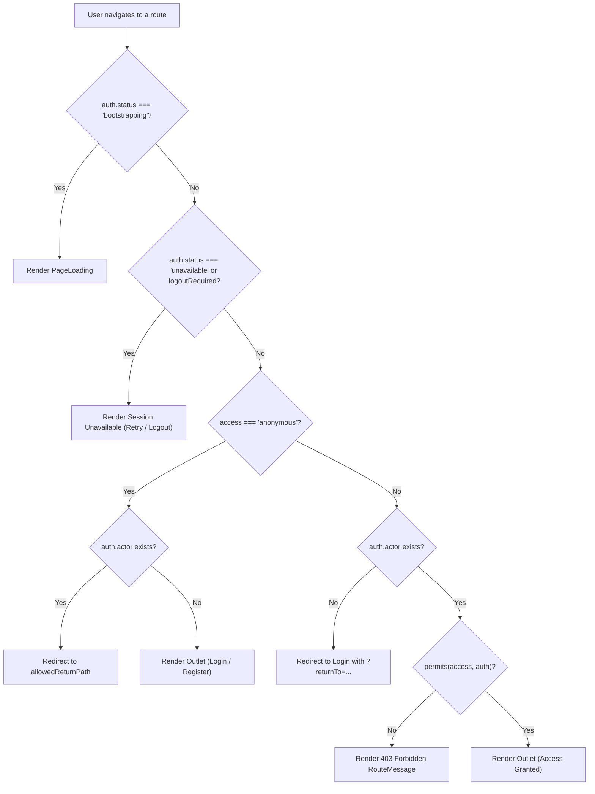

# AccessGuard (`src/Router/AccessGuard.tsx`) Explained

## 1. What This File Is
`AccessGuard.tsx` is a **React Router layout guard component** that acts as the central security and authentication checkpoint for protected routes in the application.

Instead of each page checking if a user is logged in, has the right permissions, or is in the middle of session loading, `AccessGuard` wraps around route groups and handles these checks declaratively before child route components can render.

---

## 2. Core Responsibilities & Detailed Walkthrough

### A. Frame Wrapper (`GuardFrame`)
```tsx
function GuardFrame({ standalone, children }: { standalone: boolean; children: ReactNode })
```
- For certain pages (such as staff admin login or standalone auth views where full application chrome or headers may not be visible), `standalone` is `true`.
- When `standalone` is `true`, it wraps the fallback feedback (loading, error, or forbidden screens) inside `<main id="route-content" tabIndex={-1} className="mx-auto max-w-4xl px-5 py-10 sm:px-10">` to ensure accessible keyboard navigation and proper centering.

### B. Route Access Levels
`AccessGuard` accepts an `access` prop of type `Access` (defined in `routeDefinitions.ts`):
- `"anonymous"`: Only unauthenticated guests allowed (e.g., Login, Register).
- `"customer"`: Only authenticated customers allowed (e.g., `/account`).
- `"staff"`: Only authenticated staff members (Admins & SuperAdmins) allowed (e.g., `/admin`).
- `"superAdmin"`: Only staff members with `UserRole.SuperAdmin` allowed (e.g., `/admin/users`).
- `"member"`: Any authenticated actor (`customer` or `staff`).
- `"public"`: Anyone (handled directly in router without guards).

---

## 3. Step-by-Step Execution Flow

When a user navigates to a route wrapped by `<AccessGuard access={...} />`, the component evaluates conditions in a strict sequence:

1. **Bootstrapping Phase (`auth.status === "bootstrapping"`):**
   - The app is initializing or determining if an active session exists (checking HTTP-only cookies, calling `/profile`, or refreshing tokens).
   - Renders `<PageLoading />` so users don't see brief flickering of unauthorized or blank pages.

2. **Unavailable / Session Conflict Phase (`auth.status === "unavailable" || (auth.status === "anonymous" && auth.logoutRequired)`):**
   - Renders an error screen if the session cannot be verified (e.g., network failure, refresh lock issue, or an existing session must be cleanly logged out before another can proceed).
   - Provides a **Retry** button (`auth.retryBootstrap()`) and a **Logout** button (`auth.logout()`).

3. **Anonymous Gate (`access === "anonymous"`):**
   - For login or registration routes:
     - If the user is already authenticated (`auth.actor` exists), redirect them away via `<Navigate replace to={allowedReturnPath(...)} />` (either to the URL specified in `?returnTo=` or their respective dashboard).
     - If the user is not authenticated, render `<Outlet />` to display the login or registration form.

4. **Authentication Check (`!auth.actor`):**
   - For protected routes (`customer`, `staff`, `superAdmin`, `member`), if the user is not logged in:
     - Redirects them to the login page (`/admin/login` for staff/superAdmin, `/login` for customers).
     - Preserves the current path in the query string (`?returnTo=...`) so they return after signing in.

5. **Authorization / Permission Check (`!permits(access, auth)`):**
   - If the user is logged in, but does not satisfy the specific clearance (e.g., a customer trying to open `/admin`, or an admin trying to access a superAdmin route):
     - Displays a 403 Forbidden `<RouteMessage kind="forbidden" ... />` with a button to return to their authorized home (`actorHome(auth)`).

6. **Access Granted (`<Outlet key={...} />`):**
   - If all checks pass, it renders `<Outlet key={`${auth.actor}:${auth.profile.id}:${auth.generation}`} />`.
   - The unique key ensures that if a user logs in, switches accounts, or if a new session generation starts, React unmounts the previous page state and mounts a clean component tree.

---

## 4. Execution Flow Diagram



---

## 5. Role in the Project

- **Where it sits:** In the routing architecture (`src/Router/router.tsx`), wrapping route groups for `/account`, `/login`, `/register`, `/admin/login`, `/admin`, and `/admin/users`.
- **Dependencies:** Relies on `useAuth()` (`AuthContext`), `routeDefinitions.ts` (`permits`, `allowedReturnPath`, `actorHome`), and UI feedback components (`PageLoading`, `RouteMessage`).
- **What depends on it:** All private customer pages, administrative consoles, and auth forms.

---

## 6. What Would Happen Without It

1. **Security Vulnerabilities & Data Exposure:** Unauthenticated visitors could mount administrative and customer dashboards. Protected components would attempt to access `auth.profile.id` or make authenticated requests, causing uncaught errors or exposing private UI layouts.
2. **Infinite Redirects or Bad UX:** Logged-in users navigating to `/login` would see a redundant login form instead of being directed to their account or dashboard.
3. **State Contamination:** Without the key generation boundary (`key={`${auth.actor}:${auth.profile.id}:${auth.generation}`}`), state from one user session could persist across logins in the same tab.
