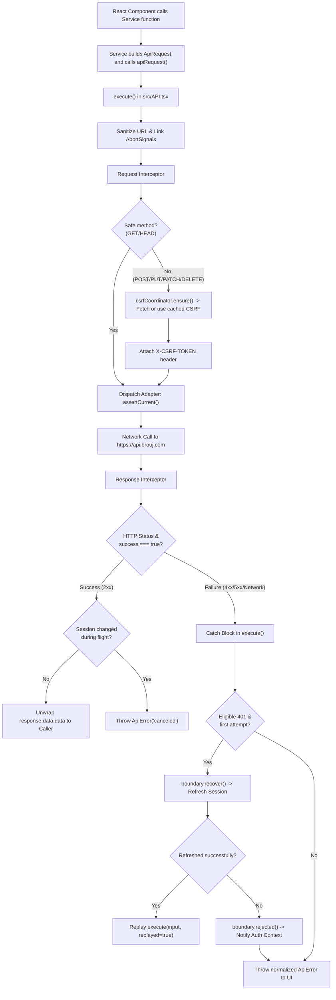

# Deep-Dive Explanation: `src/API.tsx`

## 1. What This File Is

`src/API.tsx` is the **central network gateway and sole HTTP transport layer** for the entire Brouj frontend application. It wraps an [Axios](https://axios-http.com/) instance inside a secure, typed, session-aware facade (`apiRequest`) that handles CSRF protection, silent 401 authentication recovery, request cancellation, URL path sanitization, and structured error normalization.

No other file in the application is permitted to import or configure Axios at runtime. All 101+ backend services call `apiRequest<T>()`, guaranteeing that every request adheres to the exact same security and session policies.

---

## 2. Why All the Complexity? (Tutorial vs. Real-World Enterprise)

In simple tutorial projects, an API file is typically just 10 lines:

```ts
// What beginners usually see:
const api = axios.create({ baseURL: "https://api.example.com" });
api.interceptors.request.use((config) => { ... });
export default api;
```

While that works for a toy app, in a **production real-estate & financial enterprise platform** like Brouj, that naive approach fails in four major ways:

1. **The CSRF Problem:** The backend rejects any state-changing request (`POST`, `PUT`, `PATCH`, `DELETE`) without a valid `X-CSRF-TOKEN` header. If five components mount at the same time and make five `POST` requests, a naive client would fire 5 redundant calls to fetch 5 CSRF tokens, or crash. `API.tsx` uses a generation-based `csrfCoordinator` that fetches the token **once**, shares it across all concurrent requests, and caches it.
2. **The 401 Token Expiry & Thundering Herd Problem:** When a customer's session cookie expires while they are using the app, the server returns HTTP 401. A naive app kicks the user to `/login` immediately, losing their unsaved inputs. `API.tsx` intercepts that 401, pauses the request, requests a silent background session recovery via `sessionBoundary`, and upon success, automatically replays the original request. If multiple requests fail with 401 at the same second, they all pause and wait on a **single** recovery attempt rather than spamming the auth server.
3. **Session Desynchronization & Leaks Across Tabs:** If a user logs out or switches accounts in another browser tab, any in-flight requests that were started under the old user must **never** be allowed to complete or write data under the new user. `API.tsx` checks `sessionStamp` and `generation` before sending, at dispatch, and after receiving a response. If the session changed in between, the request is discarded immediately (`ApiError("canceled")`).
4. **Information Leakage & Raw Error Safety:** Raw Axios errors include raw request URLs, internal server stack traces (`System.NullReferenceException`), and authorization headers. `API.tsx` intercepts every response and normalizes it into a predictable, sanitized `ApiError` class with safe, bilingual-friendly field validation messages.

---

## 3. Detailed Walkthrough: Types and Functions

### A. Internal Types (Lines 12–19)

```ts
interface InternalMetadata extends RequestMetadata {
  generation: number;
  csrfBootstrap?: boolean;
  onDispatch?: () => void;
  sessionStamp?: SessionStamp;
}

type InternalConfig = InternalAxiosRequestConfig & { brouj?: InternalMetadata };
```

- **`InternalMetadata`**: Extends the public `RequestMetadata` (which carries `operation`, `authenticated`, `skipAuthenticationRecovery`, etc.) with internal tracking state:
  - `generation`: An integer incremented whenever CSRF or identity changes. If a request was prepared under generation 1, but the user logged out (moving the app to generation 2), the request is identified as stale and aborted.
  - `csrfBootstrap`: A flag marking the special request that fetches the CSRF token itself, preventing an infinite loop (where fetching a CSRF token tries to wait for a CSRF token).
  - `onDispatch`: A callback executed the exact millisecond the request leaves the browser for the network wire.
  - `sessionStamp`: Holds the current session generation and revision from `sessionBoundary`.
- **`InternalConfig`**: Merges Axios's internal request configuration with our custom `brouj` metadata bag so interceptors and adapters can read it.

---

### B. Helper Functions (Lines 21–65)

#### 1. `safe` Set (Line 21)
```ts
const safe = new Set(["GET", "HEAD", "OPTIONS"]);
```
Under HTTP specifications (RFC 9110), `GET`, `HEAD`, and `OPTIONS` are "safe" read-only methods. They do not alter server state and therefore **do not require CSRF tokens**. Any method outside this set (`POST`, `PUT`, `PATCH`, `DELETE`) is considered "unsafe" and will automatically receive CSRF validation and session write-blocking.

#### 2. `retryHeader` (Lines 23–25)
```ts
function retryHeader(headers: object): unknown {
  return Object.entries(headers).find(([name]) => name.toLowerCase() === "retry-after")?.[1];
}
```
Case-insensitively extracts the standard HTTP `Retry-After` header sent by rate-limited (429) or overloaded (503) backend servers, so the UI can inform the user how many seconds to wait before trying again.

#### 3. `normalize` (Lines 27–48)
```ts
function normalize(error: unknown): ApiError
```
Converts any unknown JavaScript error into a clean, uniform `ApiError`:
- If it's already an `ApiError`, return it unchanged.
- If it was canceled (via `axios.isCancel` or DOM `AbortSignal`), return `new ApiError("canceled")`.
- If it's an Axios HTTP error with a response (`error.response`), run it through `failureFromResponse` to extract feature error codes, validation errors, and HTTP status codes.
- If it timed out (`ECONNABORTED` or `ETIMEDOUT`), return `new ApiError("transport")`.
- If the network went down entirely (DNS failure, offline), return `new ApiError("network")`.
- Anything else returns `new ApiError("unknown")`.

#### 4. `waitForRecovery` (Lines 51–65)
```ts
function waitForRecovery(work: Promise<boolean>, signal?: AbortSignal): Promise<boolean>
```
When a request is paused waiting for a 401 session refresh to finish, the user might click "Cancel" or navigate to another page. This function ensures that if the *individual request* is aborted, that request stops waiting immediately without aborting the shared background refresh that other requests might still depend on.

---

### C. The Transport Factory: `createApiTransport` (Lines 68–245)

Why is `createApiTransport` a function rather than just writing the code at the module root?
**Dependency Injection and Test Isolation.**
During automated unit testing, Vitest passes a mock adapter, isolated test CSRF coordinators, and isolated session boundaries so tests don't pollute each other. In production, line 247 instantiates it with real singleton coordinators.

#### 1. Axios Instance Configuration (Lines 74–81)
```ts
const client = axios.create({
  baseURL: environment.apiOrigin,
  withCredentials: true,
  timeout: 15_000,
  withXSRFToken: false,
  headers: { Accept: "application/json" },
});
```
- `baseURL`: Points to `https://api.brouj.com` (or local backend).
- `withCredentials: true`: Instructs the browser to send HttpOnly `Set-Cookie` session cookies with cross-origin requests.
- `timeout: 15_000`: Strict 15-second timeout prevents network calls from hanging indefinitely.
- `withXSRFToken: false`: **Crucial security setting.** Tells Axios NOT to read browser cookies for XSRF tokens. Brouj uses HttpOnly cookies that JavaScript cannot (and should not) read. CSRF tokens are managed explicitly in memory.

#### 2. `assertCurrent`: The 3 Security Checkpoints (Lines 85–97)
```ts
function assertCurrent(config: InternalConfig) {
  if (config.signal?.aborted) throw new ApiError("canceled");
  if (!safe.has((config.method ?? "GET").toUpperCase()) && config.brouj?.generation !== security.generation()) {
    throw new ApiError("canceled");
  }
  if (config.brouj) {
    boundary.assert(config.brouj, !safe.has((config.method ?? "GET").toUpperCase()), config.brouj.sessionStamp);
  }
}
```
This function is called:
1. Before request execution.
2. Inside the request interceptor.
3. At the exact dispatch adapter before sending over the wire.

It validates:
- Was the request canceled by the component?
- Did the CSRF generation change (e.g., logout happened)?
- Does the session boundary still permit this request? (e.g. blocking writes while a session transition is active).

#### 3. Custom Dispatch Adapter (Lines 100–104)
```ts
client.defaults.adapter = (config: InternalConfig) => {
  assertCurrent(config);
  config.brouj?.onDispatch?.();
  return delegate(config);
};
```
By wrapping Axios's internal adapter, we hook into the exact moment **after** interceptors have resolved and request bodies are serialized, right before the bytes leave the browser. It marks `dispatched = true` and verifies session validity one final time.

#### 4. `loadProof`: Bootstrapping CSRF (Lines 106–122)
Fetches a new CSRF token from `GET /api/v1/auth/csrf`.
Notice the metadata:
- `skipAuthenticationRecovery: true`: A CSRF request must never trigger a 401 recovery loop.
- `csrfBootstrap: true`: Tells the interceptor "do not try to inject a CSRF token on this call, because this call is the one getting the token!"

#### 5. Request Interceptor (Lines 124–134)
```ts
const requestInterceptor = client.interceptors.request.use(async (config: InternalConfig) => {
  assertCurrent(config);
  if (!config.brouj?.csrfBootstrap && !safe.has((config.method ?? "GET").toUpperCase())) {
    const proof = await security.ensure(loadProof, config.signal as AbortSignal | undefined);
    assertCurrent(config);
    config.headers.set("X-CSRF-TOKEN", proof.value);
  }
  if (config.data instanceof FormData) config.headers.setContentType(false);
  return config;
});
```
- If the method is unsafe (`POST`, `PUT`, `DELETE`, `PATCH`), it asks `security.ensure` for a valid CSRF token and sets the `X-CSRF-TOKEN` header.
- If sending `FormData` (file upload), it suppresses Axios's default `Content-Type` header so the browser can calculate the proper multipart boundary string automatically.

#### 6. Response Interceptor (Lines 136–145)
```ts
const responseInterceptor = client.interceptors.response.use(
  (response) => {
    if (response.status < 200 || response.status >= 300 || (isRecord(response.data) && response.data.success === false))
      throw failureFromResponse(response.status, response.data, retryHeader(response.headers));
    if (!isRecord(response.data) || response.data.success !== true || !Object.hasOwn(response.data, "data") || response.data.data === undefined)
      throw new ApiError("transport", { status: response.status });
    return response;
  },
  (error: unknown) => Promise.reject(normalize(error)),
);
```
- Backend returns a standard envelope: `{ success: true, data: T, message: string }`.
- If `success === false` (even if HTTP status was 200), it treats it as a failure.
- If the JSON envelope is missing `data` or `success: true`, it rejects as an invalid transport response.
- All network and HTTP errors are passed through `normalize()`.

---

### D. The Core Engine: `execute<T>` (Lines 149–225)

This function runs whenever any service invokes `apiRequest(...)`.

#### Step 1: Signal Linking & Session Locking (Lines 150–165)
It takes two potential abort signals:
1. `input.signal`: Passed by the React component (e.g. user navigated away).
2. `boundary.signal`: Triggered globally by the session coordinator (e.g. user logged out).
It links them together into `linked` so whichever fires first cleanly cancels the request.
`boundary.enter()` records that an active network request is in flight.

#### Step 2: Path & URL Sanitization (Lines 166–172)
```ts
if (
  disposed ||
  !input.path.startsWith("/api/v1/") ||
  /[\\?#]/.test(input.path) ||
  new URL(input.path, environment.apiOrigin).pathname !== input.path
)
  throw new ApiError("unknown");
```
Blocks security vulnerabilities:
- Prevents querying endpoints outside `/api/v1/`.
- Blocks path traversal attacks (`/api/v1/../admin`).
- Blocks illegal characters like `\`, `?`, or `#` inside the route path itself.

#### Step 3: Dispatch & Response Unwrapping (Lines 173–191)
Dispatches via `client.request(...)`.
Before returning `response.data.data`, it verifies whether the session changed while the network call was waiting. If the session changed, the result is discarded (`throw new ApiError("canceled")`).

#### Step 4: Silent 401 Recovery and Replay (Lines 192–219)
If the request fails with HTTP 401 and was an authenticated request:
1. Check eligibility: Was it already dispatched? Is it not marked `skipAuthenticationRecovery`? Has it not already been replayed?
2. If eligible:
   - Call `boundary.recover(stamp)` to trigger session refresh.
   - Wait on `waitForRecovery(...)`.
   - If recovery succeeds and the session is still valid: call `execute<T>(input, true)` to **replay the request transparently!**
3. If recovery fails or the replayed request still returns 401:
   - Call `boundary.rejected(stamp)`.
   - Fire `authFailures.notify(...)` to alert `AuthContext` to transition the app state to logged-out.

#### Step 5: Cleanup & Identity Invalidation (Lines 220–224)
- Calls `leave()` to release the session boundary lock.
- Cleans up abort event listeners to prevent memory leaks.
- If the operation changes identity (e.g. login, logout, register), it calls `security.invalidate()` to purge old CSRF tokens and increment the generation counter.

---

## 4. Execution Flow Diagrams

### Diagram 1: High-Level Request Lifecycle



---

### Diagram 2: Silent 401 Auto-Recovery Flow

```mermaid
sequenceDiagram
    autonumber
    actor UI as Component / Hook
    participant API as src/API.tsx
    participant Net as Backend API
    participant Boundary as Session Boundary

    UI->>API: apiRequest({ method: 'POST', path: '/api/v1/customer/reservations' })
    API->>Net: POST /api/v1/customer/reservations (with Cookies & CSRF)
    Net-->>API: 401 Unauthorized (Access token expired)
    
    Note over API: Request paused; checking recovery eligibility
    API->>Boundary: recover(sessionStamp)
    Boundary->>Net: POST /api/v1/customer/auth/refresh-session
    Net-->>Boundary: 200 OK (New Session Cookies)
    Boundary-->>API: Recovery Succeeded (true)
    
    Note over API: Replaying original request transparently
    API->>Net: POST /api/v1/customer/reservations (replayed = true)
    Net-->>API: 200 OK { success: true, data: { reservationId: "..." } }
    API-->>UI: Returns reservation data (UI never saw the 401!)
```

---

## 5. Where to Place Debugger Breakpoints

When troubleshooting API issues, place breakpoints at these key lines:

| Purpose | Line in `src/API.tsx` | What to Inspect |
|---|---|---|
| **1. Request Entry** | Around line `150` (`async function execute`) | Inspect `input.path`, `input.method`, `input.body`, and `input.metadata` before any processing starts. |
| **2. CSRF Attachment** | Around line `129` (`config.headers.set("X-CSRF-TOKEN", proof.value)`) | Check if the CSRF token was retrieved properly and verify `proof.value`. |
| **3. Dispatch Seam** | Around line `101` (`assertCurrent(config)`) | Verify whether the request is allowed through or if it was blocked by session generation. |
| **4. Raw Response** | Around line `137` (`(response) => { ... }`) | Check `response.status`, `response.data`, and see if the backend returned validation errors. |
| **5. 401 Recovery** | Around line `201` (`if (eligible && !replayed)`) | Triggered when a 401 occurs; inspect whether `boundary.recover()` succeeds or fails. |
| **6. Catch / Error** | Around line `193` (`const failure = normalize(error)`) | Inspect normalized `failure.kind`, `failure.status`, and `failure.fieldErrors`. |

---

## 6. Role in the Wider Project

```
[React Pages / Hooks / Components]
             │
             ▼
[Feature Services (e.g. CustomerProfile.ts, Units.ts)]
             │
             ▼
[src/API.tsx: apiRequest<T>()] ◄───► [Security (csrf.ts, sessionBoundary.ts)]
             │
             ▼
[Axios Client & Interceptors]
             │ (HTTPS + HttpOnly Cookies + CSRF Header)
             ▼
[Backend API: https://api.brouj.com]
```

- **Imports it:** All 101 generated service endpoints under `src/Services/*.ts` import `apiRequest`.
- **Coordinates with:** `src/Security/csrf.ts` (CSRF deduplication), `src/Security/sessionBoundary.ts` (session locks), and `src/Security/authenticationFailures.ts` (auth notifications).
- **Relies on:** `src/config/environment.ts` for the API URL, and `src/Types/failures.ts` for safe error contracts.

---

## 7. What Would Happen Without This File?

If `src/API.tsx` were replaced with a naive 10-line Axios instance:

1. **CSRF Failures (HTTP 403):** Any form submission or button that creates, updates, or deletes data would immediately fail with 403 Forbidden because CSRF tokens would not be fetched or sent.
2. **Abrupt Session Logouts on 401:** Any time a user's session expired while reading or filling out a form, they would immediately be ejected to the login screen, destroying their in-progress form inputs.
3. **Thundering Herd Crashes:** If 5 requests hit 401 simultaneously, the app would launch 5 simultaneous refresh requests, causing race conditions and revoking the refresh token on the backend.
4. **Cross-Tab Data Pollution:** If a user logs out in Tab 1, background requests pending in Tab 2 could resolve and display private information or commit actions under the wrong identity.
5. **Security Information Leaks:** Unsanitized backend stack traces and sensitive database error messages would leak directly into the browser DOM and React UI state.
