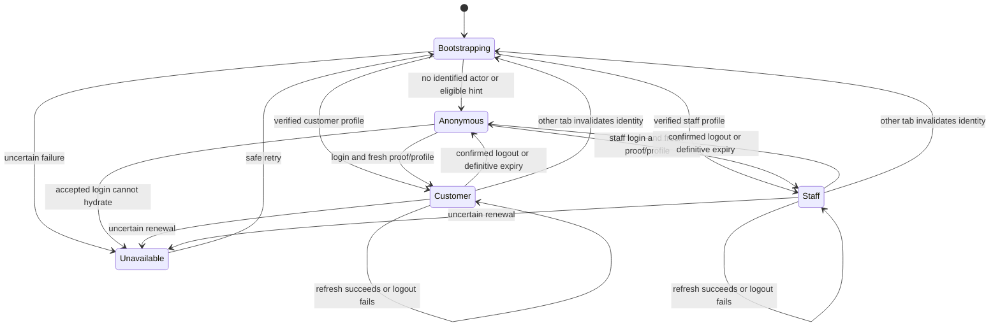

# Authentication and session lifecycle

Part 04 adds the root AuthProvider, useAuth, the plain session coordinator and reusable customer login/registration and staff login pages. Part 05 connects `/login`, `/register` and `/admin/login` to the guarded public/account/admin route trees. The internal development review remains `/__auth`. See [routing and access](routing-access.md) for layout and navigation behavior.

## State and ownership

Part 07 adds `reloadIdentity()` for an explicit read of the current actor after profile/password changes. It accepts only the same actor and ID, keeps the generation for a successful read, and retains confirmed identity on a network failure so form edits survive. Definitive rejection expires the identity and clears guarded private state. It does not guess an authentication refresh. A wrong-current-password feature response is a business 401: that mutation explicitly skips transport authentication recovery, preventing automatic password-request replay. The current backend updates the password hash without revoking its session; the frontend rechecks identity and follows any actual rejection.

AuthContext exposes bootstrapping, anonymous, customer, staff or unavailable. Customer includes CurrentCustomerDto; staff includes UserDto and its numeric Admin/SuperAdmin role. Login metadata contains only actorId and refresh-session expiresAt, so it never establishes a role. Neither JWTs nor HttpOnly cookies are read by application JavaScript.

Pending is a separate state flag, not another actor/status. Refresh retains the known profile while writes are paused; unsuccessful server logout retains that established actor. Unavailable is never treated as anonymous authorization.

`Security/sessionCoordinator.ts` owns a monotonic identity generation, a refresh revision, one shared refresh promise, transition state and cancellation controllers. `Services/session.ts` wires actual services to it. API.tsx depends only on the plain `sessionBoundary` interface, not a React context or the service-backed composition. Providers subscribe/unsubscribe safely under StrictMode. Toasts drop private notices on generation changes without remounting forms; future feature providers must similarly clear private state when generation changes.

The identity generation is distinct from the CSRF proof generation. A successful refresh of the same actor advances the refresh revision, allowing concurrent/late 401s from the previous revision to share one recovery. Identity changes advance the identity generation and prevent old requests/results from reaching the new session. Proof generation independently invalidates the proof before and after cookie identity transitions.

## Bootstrap and transitions

Reload probes the selected actor hint first, or customer first without a hint. Only definitive 401/403 identity mismatch (or recognized missing-account errors) permits the other profile probe. Network, malformed profile, 429 and 5xx failures expose unavailable/retry; they do not guess a logout or another actor. Fresh profile data corrects wrong hints.

If neither profile identifies an actor, only the persisted selected actor may refresh, and only with cross-tab locking. No hint means anonymous with no refresh attempt. The hint `brouj.actor-hint` contains only customer/staff; it is navigation metadata, never authorization. No profile, password, national ID, bearer credential or proof is stored.

Auth actions require an anonymous identified state and reject conflicting transitions or in-flight business mutations. An existing/known actor must first log out. Under the shared lock, login checks profiles again so it cannot silently overwrite a peer's newly established actor. After accepted login/registration, proof is invalidated/rebound and the matching profile is hydrated before state is authenticated. Profile failure exposes safe retry with no fabricated actor. Inputs remain local, are aborted on form unmount, and are cleared after successful acceptance/hydration or identity changes. Invalid credentials retain edits.

Part 05 detaches the pending form's cancellation listener before publishing a confirmed identity. The resulting redirect may immediately unmount the form; that cleanup must not cancel the established session's controller or break later logout. See [routing and access](routing-access.md) for anonymous-only navigation and authorized return paths.

Registration sends only the six actual fields. Names are required and capped at 100; mobile/national ID use the backend ASCII patterns; registration passwords require eight characters while existing login passwords require one. Email is trimmed and follows InputRules.Email's delegated [.NET 10 EmailAddressAttribute implementation](https://raw.githubusercontent.com/dotnet/runtime/v10.0.0/src/libraries/System.ComponentModel.Annotations/src/System/ComponentModel/DataAnnotations/EmailAddressAttribute.cs), rather than inventing a stronger mailbox regex. There is no terms field, password recovery flow or staff registration endpoint.

## Refresh and cross-tab coordination

Only an eligible, current-generation protected request's definitive 401 can recover. Auth endpoints, profile probes, session-control calls and already-replayed requests are excluded. 400/403/409/429, network errors and 5xx never trigger recovery. A successful recovery permits exactly one replay; a second 401 ends the local session. Canceling one waiting caller does not cancel another caller's shared recovery.

Refresh first invalidates proof and obtains a current proof, since expired access may appear anonymous. After rotation it invalidates/rebinds proof again, then verifies the matching profile. AuthSessionDto.expiresAt does not schedule any timer.

Where available, Web Locks serialize session transitions/refresh under `brouj.auth-session`. After acquiring the lock, the coordinator probes profiles to recognize a peer's successful refresh and avoid rotating again. Different identities cancel old replay. BroadcastChannel `brouj.session`, with storage-event fallback, carries only a random event ID and changed/uncertain kind. Receivers invalidate private state and re-probe; obsolete requests can be canceled rather than replayed into another identity. Notifications contain no profile or credentials. Without Web Locks, automatic refresh is disabled and expiry offers explicit logout/sign-in.

Definitive refresh rejection clears private identity, hint and proof and exposes sign-in. An uncertain outcome pauses writes and never blindly rotates again; retry only probes profiles until identity is confirmed or the user signs out. Cross-tab notices during a transition defer re-bootstrap until the obsolete action settles.

Logout calls the appropriate service before clearing the established local actor. A failure explicitly says server sign-out was not confirmed and permits retry. Confirmation clears state/hints/proof, advances generation and notifies tabs. Anonymous CSRF is then requested; failure of that final bootstrap does not undo a confirmed server logout. Late private responses cannot restore the prior actor.

## Verification limits

Unit tests cover coordinator state/races, real service-to-adapter bounded recovery, private notice cleanup and validation. Trusted-HTTPS Chromium tests exercise the forms in Arabic/English at 375px/1440px, native Web Locks, two tabs, BroadcastChannel and storage fallback with an intercepted API. These mocks verify frontend behavior, not real backend session rotation or SameSite/Secure cookie issuance. See the [live verification dependency](session-verification.md) and [completion report](part_04_completion.md).
