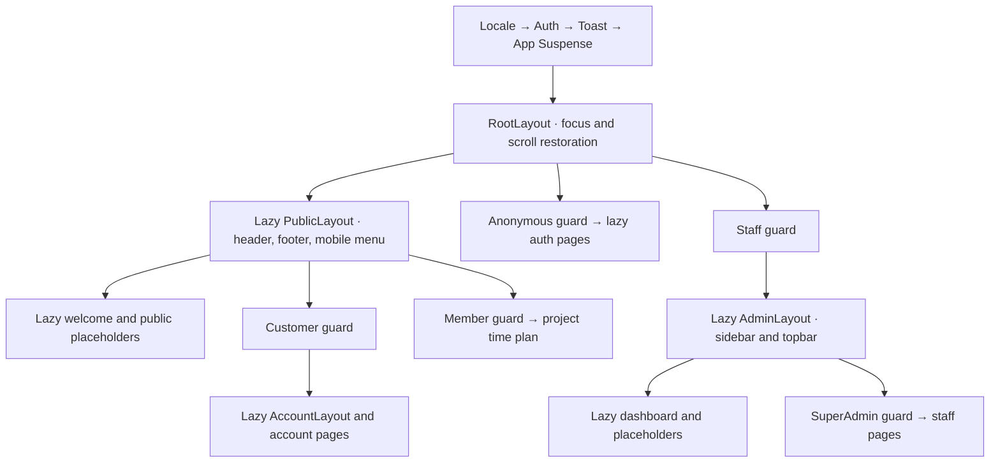

# Routing and access matrix

Part 05, verified 2026-10-29. Browser paths are language-neutral. `src/Router/routePaths.ts` exports the handwritten browser constants/builders from `browserPaths.ts` alongside the independently generated `apiPaths`. Regeneration preserves this boundary. `routeDefinitions.ts` supplies route metadata and return-path authorization without importing pages.

## Access behavior

| Access | Anonymous | Customer | Admin | SuperAdmin |
|---|---|---|---|---|
| Public | Allow | Allow | Allow | Allow |
| Anonymous only | Auth form | Allowed return or `/account` | Allowed return or `/admin` | Allowed return or `/admin` |
| Customer | `/login?returnTo=…` | Allow | 403 | 403 |
| Staff | `/admin/login?returnTo=…` | 403 | Allow | Allow |
| SuperAdmin | `/admin/login?returnTo=…` | 403 | 403 | Allow |
| Member | `/login?returnTo=…` | Allow | Allow | Allow |

Bootstrap waits before any protected branch renders. Unavailable identity stays at the requested URL with translated retry and applicable sign-out controls. An established actor of the wrong kind sees 403 and a link to their own workspace. Unknown URLs render 404 within the public, account or admin layout when that layout is permitted; unknown private URLs still pass their branch guard first. UI guards do not establish ownership or replace backend authorization.

## Routes and deferred screens

All paths below are registered now. “Placeholder” means translated heading/preparation message and navigation only: no fabricated data, feature provider, protected business read or mutation. The home page retains the approved welcome composition. Dashboard shows navigation plus the already hydrated staff name/role; it has no invented revenue or activity metrics.

| Path | Access | Current content / feature phase |
|---|---|---|
| `/` | Public | Welcome; public browsing in 06 |
| `/cities` | Public | Placeholder / 06 |
| `/cities/:cityId` | Public | Placeholder / 06 |
| `/areas/:areaId` | Public | Placeholder / 06 |
| `/projects` | Public | Placeholder / 06 |
| `/projects/:projectId` | Public | Placeholder / 06 |
| `/projects/:projectId/units/:unitId` | Public | Placeholder / 06 |
| `/terms` | Public | Placeholder / 06 |
| `/login` | Anonymous only | Customer login / 04 |
| `/register` | Anonymous only | Customer registration / 04 |
| `/admin/login` | Anonymous only | Staff login / 04 |
| `/account` | Customer | Profile placeholder / 07 |
| `/account/reservations` | Customer | Placeholder / 07 |
| `/account/reservations/:reservationId` | Customer | Placeholder / 07 |
| `/account/orders` | Customer | Placeholder / 07 |
| `/account/orders/:orderId` | Customer | Placeholder / 07 |
| `/projects/:projectId/time-plan` | Member | Placeholder / 07, shared staff access |
| `/admin` | Staff | Operational navigation and current profile / 05 |
| `/admin/catalogue` | Staff | Placeholder and catalogue links / 08 |
| `/admin/catalogue/cities` | Staff | Placeholder / 08 |
| `/admin/catalogue/cities/:cityId` | Staff | Placeholder / 08 |
| `/admin/catalogue/areas` | Staff | Placeholder / 08 |
| `/admin/catalogue/areas/:areaId` | Staff | Placeholder / 08 |
| `/admin/catalogue/projects` | Staff | Placeholder / 08 |
| `/admin/catalogue/projects/:projectId` | Staff | Placeholder / 08 |
| `/admin/catalogue/projects/:projectId/units/:unitId` | Staff | Placeholder / 08 |
| `/admin/customers` | Staff | Placeholder / 09 |
| `/admin/customers/:customerId` | Staff | Placeholder / 09 |
| `/admin/reservations` | Staff | Placeholder / 09 |
| `/admin/reservations/:reservationId` | Staff | Placeholder / 09 |
| `/admin/orders` | Staff | Placeholder / 09 |
| `/admin/orders/:orderId` | Staff | Placeholder / 09 |
| `/admin/time-plans` | Staff | Placeholder / 10 |
| `/admin/time-plans/:projectId` | Staff | Placeholder / 10 |
| `/admin/templates` | Staff | Placeholder and template links / 10 |
| `/admin/templates/stages` | Staff | Placeholder / 10 |
| `/admin/templates/items` | Staff | Placeholder / 10 |
| `/admin/terms` | Staff | Placeholder / 11 |
| `/admin/terms/:termsId` | Staff | Placeholder / 11 |
| `/admin/activity-logs` | Staff | Placeholder / 11 |
| `/admin/activity-logs/:logId` | Staff | Placeholder / 11 |
| `/admin/users` | SuperAdmin | Placeholder / 11 |
| `/admin/users/:userId` | SuperAdmin | Placeholder / 11 |
| `/admin/account` | Staff | Settings placeholder / 11 |

`/__showcase` and `/__auth` remain development-only tools. Production excludes their routes, modules and fixtures.

## Layout, pending and provider boundaries

There is one module-scope `createBrowserRouter(appRoutes)` and one `RouterProvider`. App/root Suspense provides branded initial loading. Public/account/admin layout Suspense retains navigation during page imports. Router navigation status is separate from the Suspense page-file indicator and form/API pending state. Route error boundaries show safe translated errors and a reload action, retaining the parent layout for a failed child page.

Locale/Auth/Toast foundations live above the routes. The admin layout and pages load only after the staff guard succeeds. No future feature providers were mounted early. Protected outlets key their content by actor, profile ID and generation, so later feature providers placed **inside those outlets** and local private state remount at an identity boundary. Every future async feature must still cancel requests and reject stale results; transport already supplies generation cancellation.

Page headings set localized document titles. Breadcrumbs use route metadata and static translated labels without exposing identifiers; links use the actual matched path. Navigation waits for a lazy heading before focusing it with `preventScroll`, while Router scroll restoration owns scroll positions. Mobile navigation is a non-modal disclosure with `aria-expanded`, Escape dismissal, trigger focus return and closure on navigation. Keyboard focus on navy chrome uses a gold outline.

## Return paths and authentication integration

Only `returnTo` query values beginning with a single `/` are considered. Reject absolute/protocol-relative URLs, backslashes, decoded controls/whitespace, invalid encoding, values over 2048 characters, unknown pages, authentication pages and actor-forbidden routes. Resolve against a fixed sentinel origin, match the route definition and apply the hydrated actor policy. Preserve permitted query/hash values; fall back to `/account` for customers or `/admin` for staff. Links between auth modes retain the same query, with authorization applied after hydration. Do not persist return values or private profile data in browser storage.

Identity publication can redirect and immediately unmount a login form. The coordinator detaches that form's cancellation listener **before** publishing confirmed identity (including a peer identity found under the lock). Unmount still cancels pending attempts, but cannot abort the control signal of an already accepted session. A regression test aborts synchronously during identity publication and then confirms logout remains usable.

## Live backend evidence and deployment

Read-only policy evidence: `Brouj/src/Brouj.API/Authorization/AuthorizationExtensions.cs`, `Controllers/ProjectsController.cs` and `Controllers/AdminUsersController.cs`, reconciled with the existing [API/UI matrix](contracts/api-ui-matrix.md). `MemberOnly` permits customers and both staff roles; `AdminOnly`/`StaffOnly` permit Admin/SuperAdmin; staff administration requires `SuperAdminOnly`. The numeric roles remain SuperAdmin=0, Admin=1. No contract discrepancy or backend change was introduced. Resource ownership/live account checks remain server responsibilities for the later feature phases.

Production hosting must serve HTTPS and rewrite browser navigation to `index.html`, while leaving real static files intact. Development Vite deep links/reloads are tested; deployment configuration and a published production host belong to Part 13. Run `npm run build` followed by `npm run routes:check-build` to inspect the actual production dependency graph and ensure admin chunks and development fixtures stay outside public startup imports. Real-server session verification and media/currency inputs remain in their existing [dependency record](session-verification.md).
