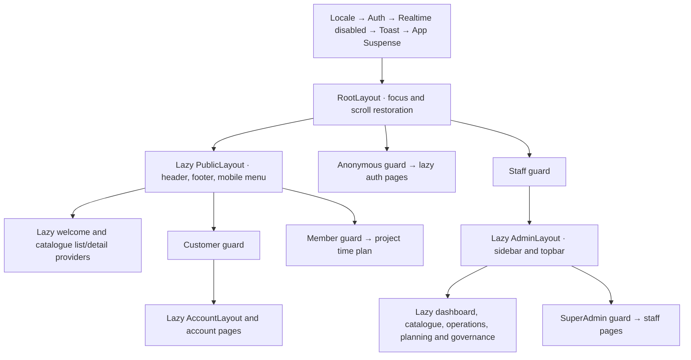

# Routing and access matrix

Routing/access documentation updated through Part 13 on 2026-10-29. Browser paths are language-neutral. `src/Router/routePaths.ts` exports the handwritten browser constants/builders from `browserPaths.ts` alongside the independently generated `apiPaths`. Regeneration preserves this boundary. `routeDefinitions.ts` supplies route metadata and return-path authorization without importing pages.

## Access behavior

| Access | Anonymous | Customer | Admin | SuperAdmin |
|---|---|---|---|---|
| Public | Allow | Allow | Allow | Allow |
| Anonymous only | Auth form | Allowed return or `/account` | Allowed return or `/admin` | Allowed return or `/admin` |
| Customer | `/login?returnTo=…` | Allow | 403 | 403 |
| Staff | `/admin/login?returnTo=…` | 403 | Allow | Allow |
| SuperAdmin | `/admin/login?returnTo=…` | 403 | 403 | Allow |
| Member | `/login?returnTo=…` | Allow | Allow | Allow |

Bootstrap waits before any protected branch renders. Unavailable identity stays at the requested URL with translated retry and applicable sign-out controls. An established actor of the wrong kind sees 403 and a link to their own workspace. Unknown URLs render 404 within the public, account or admin layout when that layout is permitted; unknown private URLs still pass their branch guard first. UI guards do not establish ownership or replace backend authorization.

## Implemented routes

All paths below have implemented screens. The home page retains the approved welcome composition. Dashboard shows navigation plus the already hydrated staff name/role; it has no invented revenue or activity metrics. Obsolete unused placeholder components were removed during Part 13. Media placeholders remain the deliberate, separately documented delivery boundary.

| Path | Access | Current content / feature phase |
|---|---|---|
| `/` | Public | Welcome, discovery/account entry links / 06 |
| `/cities` | Public | Paginated city search / 06 |
| `/cities/:cityId` | Public | City and paginated areas / 06 |
| `/areas/:areaId` | Public | Area, amenities and projects / 06 |
| `/projects` | Public | Project search/location/type filters / 06 |
| `/projects/:projectId` | Public | Project, gallery, amenities and units / 06 |
| `/projects/:projectId/units/:unitId` | Public | Unit, gallery and customer reservation confirmation / 06–07 |
| `/terms` | Public | Current published terms / 06 |
| `/login` | Anonymous only | Customer login / 04 |
| `/register` | Anonymous only | Customer registration / 04 |
| `/admin/login` | Anonymous only | Staff login / 04 |
| `/account` | Customer | Profile edit and password change / 07 |
| `/account/reservations` | Customer | Own paginated reservations / 07 |
| `/account/reservations/:reservationId` | Customer | Own detail and confirmed cancellation / 07 |
| `/account/orders` | Customer | Own paginated orders / 07 |
| `/account/orders/:orderId` | Customer | Own read-only order detail / 07 |
| `/projects/:projectId/time-plan` | Member | Published time plan / 07, shared staff access |
| `/admin` | Staff | Operational navigation and current profile / 05 |
| `/admin/catalogue` | Staff | Catalogue navigation / 08 |
| `/admin/catalogue/cities` | Staff | Bounded list and creation / 08 |
| `/admin/catalogue/cities/:cityId` | Staff | Detail/edit/delete / 08 |
| `/admin/catalogue/areas` | Staff | Bounded list and creation with city selection / 08 |
| `/admin/catalogue/areas/:areaId` | Staff | Detail/edit/delete and amenities / 08 |
| `/admin/catalogue/projects` | Staff | Bounded list and creation with area selection / 08 |
| `/admin/catalogue/projects/:projectId` | Staff | Detail/edit/delete, amenities, images and project-scoped units / 08 |
| `/admin/catalogue/projects/:projectId/units/:unitId` | Staff | Unit detail/edit/delete, amenities and images / 08 |
| `/admin/customers` | Staff | Bounded filtered list and soft-delete/restore / 09 |
| `/admin/customers/:customerId` | Staff | Customer detail and soft-delete/restore / 09 |
| `/admin/reservations` | Staff | Bounded filtered list and confirmed conversion / 09 |
| `/admin/reservations/:reservationId` | Staff | Reservation detail and confirmed conversion / 09 |
| `/admin/orders` | Staff | Bounded filtered list and supported initiative completion / 09 |
| `/admin/orders/:orderId` | Staff | Order detail and supported initiative completion / 09 |
| `/admin/time-plans` | Staff | Paginated project selection / 10 |
| `/admin/time-plans/:projectId` | Staff | Plan/stage/item/image hierarchy, ordering and template application / 10 |
| `/admin/templates` | Staff | Stage template workspace and navigation / 10 |
| `/admin/templates/stages` | Staff | Stage template CRUD, activation and ordered assignments / 10 |
| `/admin/templates/items` | Staff | Item template CRUD and activation / 10 |
| `/admin/terms` | Staff | Paginated versions and `?create=1` plain-text creation / 11 |
| `/admin/terms/:termsId` | Staff | Immutable version detail and confirmed activation / 11 |
| `/admin/activity-logs` | Staff | Paginated audit records and supported filters / 11 |
| `/admin/activity-logs/:logId` | Staff | Safe actor/resource/action/time inspection / 11 |
| `/admin/users` | SuperAdmin | Paginated staff, search/role/deletion filters and `?create=1` creation / 11 |
| `/admin/users/:userId` | SuperAdmin | Full approved update, confirmed soft-delete/restore / 11 |
| `/admin/account` | Staff | Read-only staff profile and password change / 11 |

`/__showcase` and `/__auth` remain development-only tools. Production excludes their routes, modules and fixtures.

## Layout, pending and provider boundaries

There is one module-scope `createBrowserRouter(appRoutes)` and one `RouterProvider`. App/root Suspense provides branded initial loading. Public/account/admin layout Suspense retains navigation during page imports. Router navigation status is separate from the Suspense page-file indicator and form/API pending state. Route error boundaries show safe translated errors and a reload action, retaining the parent layout for a failed child page.

Locale/Auth/disabled-Realtime/Toast foundations live above the routes. The admin layout and pages load only after the staff guard succeeds. Focused feature providers live inside protected outlets keyed by actor, profile ID and generation, so private state remounts at an identity boundary. Async features cancel obsolete requests and reject stale results; transport also supplies generation cancellation.

Page headings set localized document titles. Breadcrumbs use route metadata and static translated labels without exposing identifiers; links use actual matched paths. Path navigation waits for a lazy heading before focusing it with `preventScroll`; query-only edits preserve focus in filter controls. Router scroll restoration owns positions, with query edits opting out of resets. Mobile navigation is a non-modal disclosure with `aria-expanded`, Escape dismissal, trigger focus return and closure on navigation. Keyboard focus on navy chrome uses a gold outline. See [catalogue state and media boundaries](catalogue.md).

## Return paths and authentication integration

Only `returnTo` query values beginning with a single `/` are considered. Reject absolute/protocol-relative URLs, backslashes, decoded controls/whitespace, invalid encoding, values over 2048 characters, unknown pages, authentication pages and actor-forbidden routes. Resolve against a fixed sentinel origin, match the route definition and apply the hydrated actor policy. Preserve permitted query/hash values; fall back to `/account` for customers or `/admin` for staff. Links between auth modes retain the same query, with authorization applied after hydration. Do not persist return values or private profile data in browser storage.

Identity publication can redirect and immediately unmount a login form. The coordinator detaches that form's cancellation listener **before** publishing confirmed identity (including a peer identity found under the lock). Unmount still cancels pending attempts, but cannot abort the control signal of an already accepted session. A regression test aborts synchronously during identity publication and then confirms logout remains usable.

## Live backend evidence and deployment

Read-only policy evidence: `Brouj/src/Brouj.API/Authorization/AuthorizationExtensions.cs`, `Controllers/ProjectsController.cs` and `Controllers/AdminUsersController.cs`, reconciled with the existing [API/UI matrix](contracts/api-ui-matrix.md). `MemberOnly` permits customers and both staff roles; `AdminOnly`/`StaffOnly` permit Admin/SuperAdmin; staff administration requires `SuperAdminOnly`. The numeric roles remain SuperAdmin=0, Admin=1. No contract discrepancy or backend change was introduced. Resource ownership/live account checks remain server responsibilities for the later feature phases.

Production hosting must serve HTTPS and rewrite HTML browser navigation to `index.html`, while returning real 404s for missing assets. Part 13's [release runbook](release/runbook.md) and local compiled-artifact rehearsal cover these semantics; actual staging/host verification remains open. Run `npm run build` followed by `npm run routes:check-build` to inspect the production dependency graph, or pass a packaged site directory directly to `scripts/verify-route-bundles.mjs`. Real-server session verification, media/currency and deployment inputs remain in the [open release checks](release/open-checks.md).
